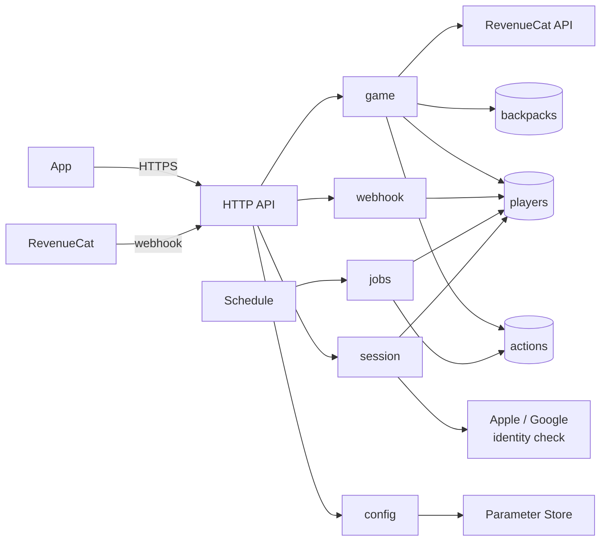

# Backend architecture

Design draft from 2026-11-17. Nothing here is built. It turns the decided requirements ([requirements.md](requirements.md), areas BE, DEV, ACC, RUN) and the flows in [client-server.md](client-server.md) into a structure that issues can be cut from. Everything marked "open" at the end still needs a decision.

Decided before this document: TypeScript, serverless on AWS Lambda, DynamoDB, AWS CDK, region Frankfurt, secrets in the Parameter Store, three environments (local, test, production), the whole system runs locally.

## At a glance

Five Lambdas behind one HTTP API, three DynamoDB tables, settings and secrets in the Parameter Store. The same handler code runs locally behind a small HTTP server.

## Where the code lives

| Path            | Content                                                                                                                                                               |
| --------------- | --------------------------------------------------------------------------------------------------------------------------------------------------------------------- |
| `packages/core` | the deterministic core, unchanged in its role                                                                                                                         |
| `packages/api`  | new: the contract between app and backend. Request and response shapes as schemas, error codes, paths. Client and backend both import it, so they cannot drift apart. |
| `apps/backend`  | new: the backend                                                                                                                                                      |
| `apps/client`   | the app; gets a small API client that uses `packages/api` and replaces today's local profile and `GhostOpponents`                                                     |
| `apps/web`      | new: the website                                                                                                                                                      |
| `infra`         | new: the cloud setup as CDK code                                                                                                                                      |

Inside `apps/backend`:

| Folder         | Content                                                                                                                   | May import                                   |
| -------------- | ------------------------------------------------------------------------------------------------------------------------- | -------------------------------------------- |
| `src/handlers` | one entry per Lambda; reads the request, calls the domain, writes the answer                                              | everything below                             |
| `src/http`     | router, schema check of every request, token check, error answers, request log                                            | `packages/api`                               |
| `src/domain`   | the rules of the backend: session, run, matching, booking, shop, refunds, account. Pure TypeScript.                       | `packages/core`, `packages/api`, `src/ports` |
| `src/ports`    | interfaces to the outside: player store, backpack pool, action store, identity check, RevenueCat, settings, clock, random | nothing                                      |
| `src/adapters` | the real implementations: DynamoDB, RevenueCat API, Apple and Google, Parameter Store                                     | AWS and other libraries                      |
| `src/fakes`    | implementations in memory for tests and for local use where a real service is not available                               | nothing outside                              |
| `local`        | the local HTTP server and the script that creates local tables                                                            | everything                                   |
| `test`         | unit tests of the domain, interface tests against the local server                                                        | everything                                   |

The one rule that keeps this testable: **`src/domain` never imports an AWS library, never reads the clock and never rolls a random number itself.** Time and randomness come through ports, as in the core. So every rule of the backend can be tested without a database and without a network.

## Lambdas

Few Lambdas grouped by what they need, not one per request. That keeps deployments simple and cold starts rare.

| Lambda    | Requests                                                                       | Loads the core | Why its own                                                                      |
| --------- | ------------------------------------------------------------------------------ | -------------- | -------------------------------------------------------------------------------- |
| `config`  | `GET /config`                                                                  | no             | must answer even when everything else is broken or in maintenance; tiny and fast |
| `session` | `POST /session`                                                                | no             | the only one that talks to Apple and Google                                      |
| `game`    | profile, runs, fight, finish, buying with Credits, account export and deletion | yes            | everything a signed-in player does                                               |
| `webhook` | `POST /hooks/revenuecat`                                                       | no             | called by RevenueCat, not by players; own secret, own limits                     |
| `jobs`    | none (timed)                                                                   | yes            | season change, clean-up, later the replay analysis                               |

Each Lambda gets only the rights it needs: `config` reads settings and nothing else, `webhook` may write to `players` but not read backpacks, and so on.

Inside a Lambda a small router maps path and method to a function. The local server uses the same router, so there is exactly one place where a path is defined.

### Every request goes through the same steps

1. Parse and check against the schema from `packages/api` (fields, types, size). Anything else is rejected before any code of ours runs on it.
2. Check the session token (not for `config`, `session`, `webhook`). The player id comes from the token.
3. Check maintenance and versions.
4. Run the domain function.
5. Answer with a body from `packages/api`, or with a fixed error code.
6. Write one log line (see "Logs and numbers").

## Sign-in and session token

- **Identity check.** The app hands in what Game Center or Play Games gave it. For Game Center the backend checks Apple's signature over player id, app id, timestamp and salt with Apple's public key. For Play Games the backend exchanges the server auth code at Google for the player id. Both need a Capacitor plugin in the app; which one is open. The exact calls have to be checked against the current Apple and Google documentation when building.
- **Player id.** A random id made by the backend at first sign-in. The store identity is stored only as the key of a lookup entry and appears in no log and in no answer.
- **Token.** A signed token with player id, platform, issue time and expiry. The signing key lives in the Parameter Store as a secure string. Two keys are accepted at once (current and previous), so a key can be changed without signing everybody out.
- **Lifetime.** Short, proposal: 1 hour. There is no refresh token: when the token has expired, the app signs in silently again, which costs the player nothing.
- **Where it is checked.** Inside the handler, in `src/http`, not in a separate authorizer Lambda. That is one call less per request and works the same locally.
- **Local and browser tests.** A development identity ("player 1", "player 2") replaces Game Center and Play Games. The backend accepts it only when a setting says so, and that setting does not exist in test and production.
- **Code.** Token: `apps/backend/src/http/token.ts` (`v1.<claims>.<signature>`, HMAC-SHA256, claims: player id, platform, issue time, expiry, key id). Identity checks: `apps/backend/src/adapters/store-identity.ts`; they need the settings `gameCenter.bundleIds` and `playGames.clientId`/`clientSecret` (an OAuth client of type "web", Play Console credential "Game server"). The Play Games steps were checked against developer.android.com on 2026-11-18. Apple's page could not be read automatically then: the Game Center steps follow the known procedure (player id + bundle id + timestamp as 64-bit big-endian + salt, RSA SHA-256, certificate from apple.com) and must be checked against Apple's documentation before launch.

## Data

Three tables, cut by one question: **what has to be restored together?**

| Table       | Holds                                                                                                                         | Restore to a point in time        | Deleted on its own    |
| ----------- | ----------------------------------------------------------------------------------------------------------------------------- | --------------------------------- | --------------------- |
| `players`   | everything about a player that must stay consistent: profile, ownership, the open run and its rounds, handled purchase events | yes                               | no                    |
| `backpacks` | the opponent pool: bot backpacks and collected player backpacks                                                               | yes, but independent of `players` | entries age out       |
| `actions`   | the recorded shop actions of every round                                                                                      | no                                | yes, after a set time |

A restore of `players` does not need the other two to be restored, because nothing in `players` points at an entry in them that could be missing: a round stores the opponent backpack it fought, not a reference to it.

All tables are billed per request (no capacity to plan at launch) and have deletion protection in production.

### Table `players`

One partition per player. One query for that partition loads everything the game needs for a request.

| Partition key             | Sort key             | Content                                                                                                                                                          |
| ------------------------- | -------------------- | ---------------------------------------------------------------------------------------------------------------------------------------------------------------- |
| `P#<playerId>`            | `PROFILE`            | name, Galaxies, hero XP, season state, equipped things, run count, refund count, a version number, created at                                                    |
| `P#<playerId>`            | `OWN#<thing>`        | one entry per owned thing (cosmetic, hero, premium pass of a season) with its origin and date                                                                    |
| `P#<playerId>`            | `RUN`                | the open run: run id, hero, round, lives, wins, the backpack after the last round, the shop seed of the current round, the opponents already met                 |
| `P#<playerId>`            | `ROUND#<runId>#<nn>` | one entry per fought round: the committed backpack, the opponent backpack with name and patch, the fight seed, the result, and the complete answer that was sent |
| `P#<playerId>`            | `DONE#<runId>`       | the booked end of a run with the complete answer that was sent                                                                                                   |
| `P#<playerId>`            | `QUEST#<questId>`    | a quest the player played, with the run id; expires 14 days after it was written                                                                                 |
| `P#<playerId>`            | `IDENTITY`           | the key of the store lookup below, so that deleting the account can remove it                                                                                    |
| `P#<playerId>`            | `EVT#<eventId>`      | a handled RevenueCat event, so that a repeated report is not booked twice                                                                                        |
| `ID#<platform>#<storeId>` | `PLAYER`             | the lookup from store identity to player id                                                                                                                      |

Notes:

- **The Credits balance is not here.** It lives at RevenueCat only ([store.md](store.md)). The profile the app gets has no Credits field from us; the app reads the balance from RevenueCat.
- **Season change** (META-03, BE-14, built in M3): the season follows the server date (`src/domain/season.ts`). The setting `season` names the current season and can be set ahead of time; until its start date the season before it runs, and only seasons the game data knows count. Every read of a profile moves a profile of an earlier season into the running one first and stores it on its version: the league patch of the season reached (origin `league`), the drop by league group, the new pass (event `season_changed`). So a player who was away gets the change at their next request, and the change happens once. The timed job `season` (`src/jobs`, Lambda `jobs`, daily shortly after midnight UTC) does the same for every profile, so the numbers are right without waiting for the players; a second run changes nothing. The job `actions` (weekly) deletes shop actions after their expiry, as a safety net for DynamoDB's own expiry and locally, where there is none. `npm run job -- season` or `npm run job -- actions` runs a job once against the local tables.
- **Profile changes are checked against ownership** (ACC-06, ACC-07, built in M3): `POST /profile/equip`, `/profile/skin` and `/profile/name` accept only owned things (else `not_owned`) and write the profile only if its version number is unchanged, retrying a few times. A name is tidied and checked against `names` in `data/meta.json` (offensive and political words, also spelled with digits or repeated letters); a refused name gets `name_rejected`. The bot pool uses the same check.
- **Ownership entries are the truth for what a player owns.** The profile sent to the app is put together from `PROFILE` and the `OWN#` entries. A refund removes exactly the entries of that origin. Origins: `start`, `level`, `planet` and `pass` (what a booked run unlocked, by its track), `league` (the league patch of a season change), later `credits` and `purchase` (M4).
- **Quests** (META-06, CORE-07, built in M3, `src/domain/quests.ts`): `GET /quests` lists the quests open on the server date (`questsOn` in the core, the same for every player) with a played mark from `QUEST#`. `POST /runs` with a quest id starts a quest run only if that quest is open today and the player has not played it (else `quest_unavailable`). The open run keeps the quest id; every fight and the finish compute with the quest's rules (`questData`). Matching uses the normal pool, with the lives mapped to the normal standing by the losses so far, and a quest backpack is never written to the pool, because it was built under other rules. Finishing books Galaxies and hero XP like a run but no league points, and writes `QUEST#` in the same transaction as `DONE#`.
- **Repeatable answers.** `ROUND#` and `DONE#` store the answer that was sent. A repeated request finds the entry and returns the same answer without computing anything.
- **Writes that belong together are one transaction.** A fight writes the round entry (only if it does not exist yet) and moves the open run forward (only if it is still at that round). Finishing a run updates the profile (only if its version number is unchanged), writes `DONE#` and removes `RUN`. Two requests at the same time cannot both win.
- **Old rounds.** `ROUND#` and `DONE#` entries carry an expiry 7 days after they are written (decided 2026-11-18: they only serve repeated requests of a run), and DynamoDB removes them on its own (`expiresAt`, as in the other tables); the backpacks live on in the pool. The recorded actions expire after 180 days (RUN-14, decided 2026-11-18).

**No move to another device.** At launch the server checks a backpack for plausibility only and does not replay the shop phase. So it does not know how much gold is left, which items lie loose and which offers are pinned. The app keeps these on the device. Continuing a run on another device or after a reinstall is not in scope for version 1 (decided 2026-11-17): if the app has no local copy of the open run, it reports that (`POST /runs/finish` with reason `no_local_copy`) and the server ends that run and books it with the standing it knows (built in M2, logged as `run_finished` with reason `abandoned`). The fight request stays as it is in [client-server.md](client-server.md).

### Table `backpacks`

| Partition key                            | Sort key             | Content                                                                        |
| ---------------------------------------- | -------------------- | ------------------------------------------------------------------------------ |
| `<origin>#<dataMajor>#R<round>#L<lives>` | `G<league>#<random>` | the backpack, name, league patch, player id (players only), data version, date |
| `DELETED`                                | `<playerId>`         | the list of deleted accounts (ACC-08): time of the deletion                    |

- The partition is the bucket of the matching rules: round and run standing (with a fixed round the lives left say everything about the standing). There are 42 buckets per origin and data version.
- `origin` is `bot` or `player`. In phase 1 the matching reads only `bot` partitions, while player backpacks are already collected in theirs.
- **Random pick inside a league:** the sort key starts with the league and then a random value. The search rolls a random value and reads the next few entries after it inside the wanted league. That gives a random opponent with one small read, without loading the bucket. The steps of the matching rules ([matchmaking.md](matchmaking.md)) are further reads with a wider league range or a neighbouring bucket.
- A second index by player id finds all backpacks of a player, for "never your own backpack" checks in bulk and for account deletion.
- Bot backpacks are written by a command (DEV-06), not by a deployment. The same command fills local and test with a small set.

### Table `actions`

| Partition key | Sort key | Content                                                                                                                 |
| ------------- | -------- | ----------------------------------------------------------------------------------------------------------------------- |
| `RUN#<runId>` | `R<nn>`  | the action lines of the round, the shop seed, the backpack before and after, simulation version, player id, expiry date |

The index `byPlayer` (player id, partition key) finds all entries of one player for the account export and deletion.

Written after the fight is committed, outside the transaction: if this write fails, the fight still counts and the failure is logged. Entries expire on their own (how long is open, RUN-14). The later analysis reads this table with a job and replays the runs with the core.

### Restoring

- `players` can be restored to any second of the last 35 days into a new table. The name of the table in use is a setting, so the backend can be pointed at the restored table without a new deployment.
- **What a restore does not bring back:** the Credits balance and the purchases live at RevenueCat and keep their current state. After a restore, a player can have fewer things than they paid for. So every purchase, every Credits booking and every refund is also written as its own log line with the RevenueCat reference. A reconcile command reads those lines from the restore point on and books the missing ownership again. This command is part of the restore test before launch (BE-12).
- **Deleted accounts must stay deleted.** A restore would bring them back. The ids of deleted accounts are therefore kept in a small list outside `players`, and the reconcile command deletes them again.
- `backpacks` is restored only if the pool itself was damaged. Bot backpacks can also simply be generated again.
- `actions` is not restored.

## The fight request, step by step

This is the heart of the backend, so here is the order inside `game`:

1. Load the player's partition from `players`.
2. If a `ROUND#` entry for this run and round exists, return its stored answer. Done.
3. Check: is there an open run, is it at this round, does the simulation version match.
4. Check the backpack for plausibility with the core (CORE-05).
5. Find an opponent in `backpacks` (never the player's own, none met before in this run).
6. Roll the fight seed and the shop seed of the next round through the random port.
7. Compute the fight with the core and work out lives and wins (a draw costs a life, as in the app). The server does not merge: gold, loose items and pins live on the device.
8. Write in one transaction: the `ROUND#` entry and the moved-on `RUN`. If the transaction fails because another request was faster, start again at step 1, which then ends at step 2.
9. After the transaction: put the player's backpack into the pool, write the actions (kept 180 days, RUN-14). A failure here is logged; the fight still counts.
10. Send the answer.

The backpack is "committed" by step 8: from then on the round has exactly one backpack and one opponent, whatever is sent afterwards.

## Versions

- **Simulation version** (CORE-03): one id made from the core and the data. The backend holds exactly one simulation build. A run request with another version gets `update_required`.
- **Open runs after a version change** (RUN-13, built in M2): a run is not tied to the version it started with. Every fight is computed once, by the server, with the simulation build the request names; the app only has to have an accepted version at that moment. So after an update an open run simply continues, also across a minor data change. Only when the data's major version changed (an item was removed or reshaped) the stored standing no longer fits: the run is ended and booked as it stands (event `run_finished` with reason `data_major`). This happens at `GET /runs/current` or at the next start; a fight request for such a run gets `run_conflict`, after which the app asks for the open run.
- **Rolling out a new version** (decided 2026-11-18, built in the domain in M2): the `game` Lambda carries two simulation builds, the current one and the previous one (`Ports.previousGame`), and uses the one the request names; any other version gets `update_required`. Order: (1) deploy the backend with the new build plus the previous one, (2) release the app, (3) once enough players have updated, raise `minAppVersion` in the settings, (4) the next deployment drops the previous build. Most balance releases change only `data/`, so the previous build is the previous data with the same core; how the deployment packs it is part of the cloud setup (#56). When `ENGINE_VERSION` changes as well, carrying two cores is not worth it: such a release uses a short maintenance window instead.
- **Data in the app**: the app ships the game data and the pictures (decided 2026-11-17). A balance change or a new item is an app release. The server carries the same data build for its checks and fights.

## Settings and secrets

Everything that differs between environments or must change without a deployment is a parameter under `/backpack-space/<environment>/`:

| Parameter                                           | Kind                                                     | Read by                  |
| --------------------------------------------------- | -------------------------------------------------------- | ------------------------ |
| `maintenance`                                       | on or off, with an optional text key                     | all                      |
| `min-app-version`                                   | version                                                  | `config`, `game`         |
| `season`                                            | the current season and its dates; set ahead of time, it starts on its date (until then the season before it runs) | `config`, `game`, `jobs` |
| `players-table`, `backpacks-table`, `actions-table` | names                                                    | those that use them      |
| `matching-phase`                                    | 1, 2 or 3                                                | `game`                   |
| `token-keys`                                        | secure string                                            | `session`, `game`        |
| `revenuecat-api-key`                                | secure string                                            | `game`, `webhook`        |
| `revenuecat-webhook-secret`                         | secure string                                            | `webhook`                |
| `dev-identity`                                      | exists only locally                                      | `session`                |

A Lambda reads its parameters at start and again at most once a minute, so a change such as the maintenance switch takes effect within a minute without a deployment. Standard parameters cost nothing.

## Local setup

| Piece               | Local                                                                                     | Cloud                   |
| ------------------- | ----------------------------------------------------------------------------------------- | ----------------------- |
| HTTP                | a small Node server in `apps/backend/local` that calls the router                         | HTTP API and Lambda     |
| Handlers and domain | the same code                                                                             | the same code           |
| Database            | DynamoDB Local in a container, tables created by a script                                 | DynamoDB                |
| Table definitions   | one file in `apps/backend` that both the local script and the CDK code read               | the same file           |
| Settings            | a local file that is not committed, with an example file beside it                        | Parameter Store         |
| Sign-in             | development identity                                                                      | Game Center, Play Games |
| RevenueCat          | a fake in memory behind the same port, or RevenueCat's test store (DEV-04, to be checked) | RevenueCat              |
| Timed jobs          | a command that runs a job once                                                            | schedule                |

Commands: `npm run db` starts the container and creates the tables (`db:stop` stops it, `db:reset` also removes the data), `npm run backend` starts the local server, `npm run dev` starts database, backend and client together; `npm run seed` fills the opponent pool with bot backpacks and replaces the bot backpacks that were there (5 per bucket; `-- --launch` for the launch set of 50 per bucket, `-- --dry` only counts; generator in `apps/backend/src/seed/bot-pool.ts`). The table definitions are in `apps/backend/src/tables.ts`, the container in `apps/backend/local/compose.yaml`, the settings in `apps/backend/local/settings.json` (copy `settings.example.json`; without it the example is used). The client learns the address of the backend from a build setting.

Interface tests start the local server against DynamoDB Local and call it over HTTP, exactly as the app does. The same tests can be pointed at the test environment after a deployment.

## Cloud setup and rollout

- **Stacks.** One CDK app with one stack per environment, built from the same code with different settings. Proposal: test and production in the same AWS account with different name prefixes, to keep it simple and cheap; two separate accounts are cleaner and can be introduced later without changing the code.
- **HTTP API without a firewall in front at launch.** The HTTP API has its own request limits per route. A web firewall (AWS WAF) needs CloudFront in front of the API and has a fixed monthly cost. Proposal: start without it and add it when the logs show abuse. This differs from the first sketch in the review and is listed as open.
- **Request limits** (BE-06): limits per route at the HTTP API; limits per player come mostly from the rules themselves (one open run, one fight per round, an answer per round is computed once). The webhook route accepts only requests with the secret. The numbers are the setting `limits` (steady requests per second over all players, plus a burst); the cloud setup puts them on the HTTP API, the local server applies them itself (`apps/backend/src/http/throttle.ts`), and above them the answer is `rate_limited`. Decided (2026-11-18) from the expected play speed: at 100,000 runs a day there are about 14 fights a second on average; with five times that at peak, `runFight` gets 100/s (burst 200), `runStart` and `runFinish` 20/s (burst 50), `config`, `session`, `profile` and `runCurrent` 50/s (burst 100). Raise them with the numbers after launch.
- **Rollout** (BE-13): a merge to the main branch runs the checks and then deploys to test. Production is deployed by a manual step that names the commit. GitHub signs in to AWS with a short-lived role, not with stored keys.
- **Order of a rollout:** tables and settings first, then the Lambdas. A change of a table or of a stored shape must be readable by the old and the new code, because both run for a moment.

## Logs and numbers

- **One line per request**, as JSON: time, request id (also sent back as `x-request-id`), route, player id, status, error code, duration, app version, simulation version. No names, no store identities, no backpacks, not the path of an unknown route. Event lines carry the same request id. Code: `apps/backend/src/http/router.ts` (request line), `apps/backend/src/domain/log.ts` (events and their fields).
- **One line per event that counts**: `run_started`, `fight`, `run_finished`, `purchase`, `credits_spent`, `credits_earned`, `refund`, `account_deleted`, `season_changed`, `plausibility_rejected`, `result_mismatch`, `client_error`. These lines are the source of the usage numbers (BE-10) and of the reconcile command after a restore.
- **Crash and error reports of the app** (BE-15, built in M6): proposal, our own endpoint instead of a crash service of another company, so no further processor and no extra kit in the app. The app sends every uncaught error and every failed promise nobody waits for to `POST /reports/error` (no sign-in, open in maintenance and to old apps): kind, message, stack, simulation version; the app version comes from the header. Each message once per session, at most 5 per session (`apps/client/src/crash.ts`). The backend writes it as the event `client_error` (`src/domain/reports.ts`) and cuts query strings out of addresses. What leaves the device: code text of the error and the two versions, plus the IP address every request has; no player id, name or backpack. For the privacy policy: "When the app fails, it sends the error message and the app version to our server, without your player id." Native crashes of the app shell (Capacitor) are not caught this way; for them the store's built-in reports (Play Console, Xcode Organizer) are enough at launch.
- **Alarms** (BE-11): error rate and response time of the API, failed Lambda runs, rejected webhooks, throttled database requests, and a cost alarm.
- Logs are kept for a set time (proposal: 90 days for request lines; the event lines needed for reconciling at least as long as the restore window).

## Account deletion and export

Built in M6 (`src/domain/account.ts`, settings → account in the app).

- **Export** (`GET /account/export`) returns the player's partition from `players` plus their entries in `actions` (index `byPlayer`), as they are stored. The app hands it over as a JSON file (share sheet where there is one, else a download).
- **Deletion** (`DELETE /account`, after a confirmation in the app) first writes the id to the list of deleted accounts, then removes the store lookup (found through the partition's `IDENTITY` entry), the partition (in steps of 25, a transaction holds at most 100 items), the player's `actions` entries at once (decided as a proposal: they hold backpacks and the player id, and waiting for their expiry gains nothing), and the customer at RevenueCat (M4 fills in the real call; locally a stand-in). The player's backpacks in the pool stay as opponents but lose player id, owner, name and patch (they get a generated name like "Pilot 417"), so nothing in them points to a person any more. Event `account_deleted`. The app then forgets run and profile and starts again; the same store identity becomes a new player with a new profile.
- **The list of deleted accounts** lives in the table `backpacks` (partition `DELETED`): outside `players`, so a restore of `players` does not roll it back, and with point-in-time restore of its own. Every step of a deletion can run again, so the timed job `deleted` (`npm run job -- deleted`) deletes every listed account again after a restore of `players`, or finishes a deletion that stopped half-way. It is part of the reconcile after a restore (BE-12).
- A session token stays valid until it expires (ACC-04); the app drops it after the deletion. A sign-in of the deleted identity finds no profile behind its lookup and starts a new player.
- The cloud HTTP API has to allow the method `DELETE` in its CORS setting (#56), as the local server does.
- **Store rules (LB-07):** Apple asks apps that create accounts to let players start the deletion inside the app (App Review Guideline 5.1.1(v)); Google Play asks for deletion inside the app and, in the data safety form, a web address where a deletion can be requested without the app. The in-app deletion covers both; the web address is the website's support page (WEB-04), which names the support address. Check again when the store listing is prepared (LB-07, from memory of the rules, not checked against the current store pages).
- What has to be kept by law about purchases is held by the stores and RevenueCat, not by us.

## What this means for the app

- `apps/client` gets an API client built on `packages/api`. It replaces `GhostOpponents` behind `OpponentSource` and the local profile in `src/profile.ts`.
- The local save of a run stays as a copy for the shop phase in progress; at start the app asks the server for the open run and trusts the server.
- The app shows the states from the error codes (UX-02).
- The client's season date check (`today()` in `src/profile.ts`) goes away; the date comes from `config`.

## Open

| Point                                                                                                      | Kind                |
| ---------------------------------------------------------------------------------------------------------- | ------------------- |
| What happens to an open run without a local copy (proposal: end it and book the known standing)            | needs designer      |
| Test and production in one AWS account or in two                                                           | technical           |
| Start without a web firewall                                                                               | technical           |
| Token lifetime (proposal 1 hour)                                                                           | technical           |
| Which Capacitor plugins for Game Center and Play Games sign-in                                             | technical           |
| Whether RevenueCat can list a customer's Credits bookings (would make reconciling after a restore simpler) | technical, to check |
| Whether `actions` should be a table or files in S3, if the analysis turns out to be easier there           | technical           |
