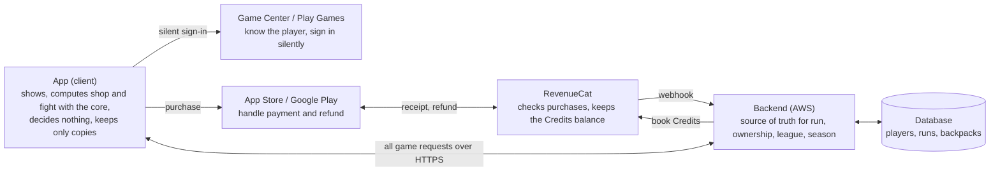
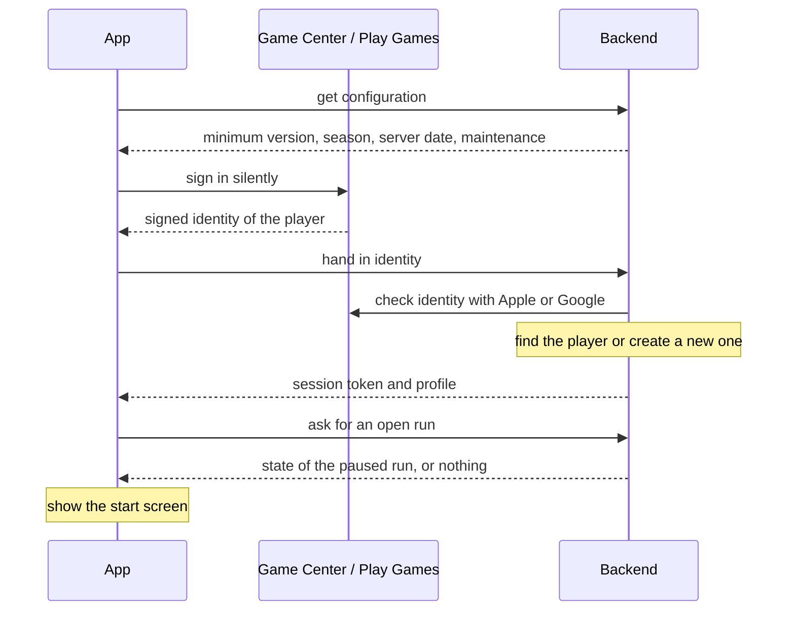
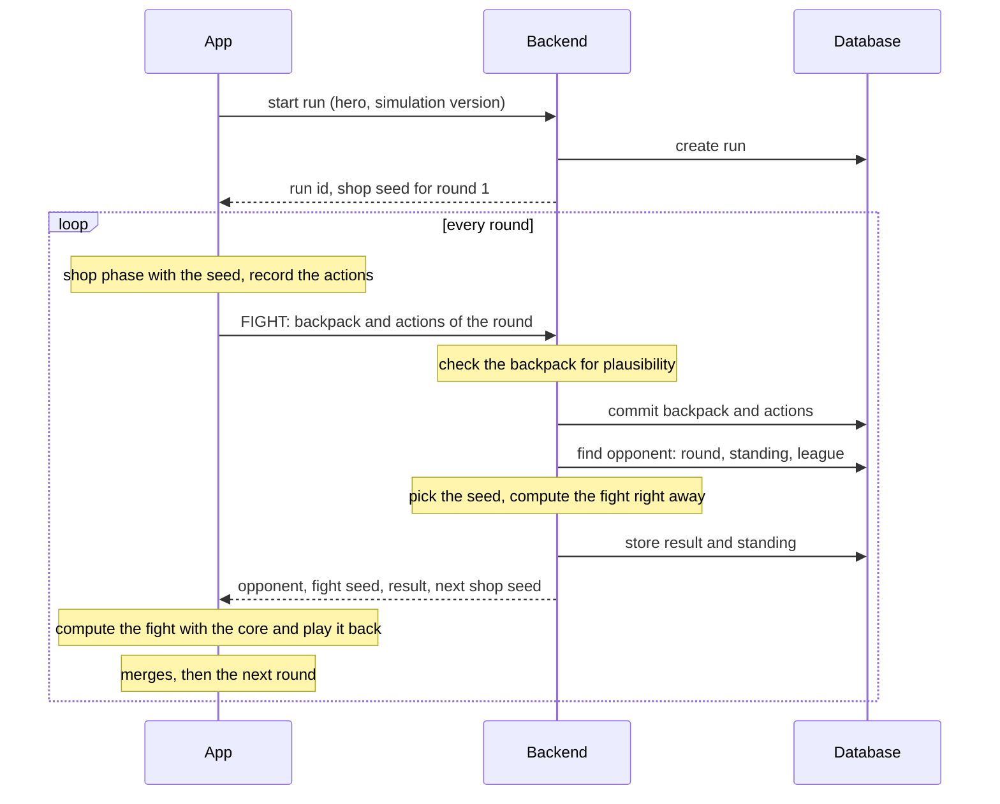
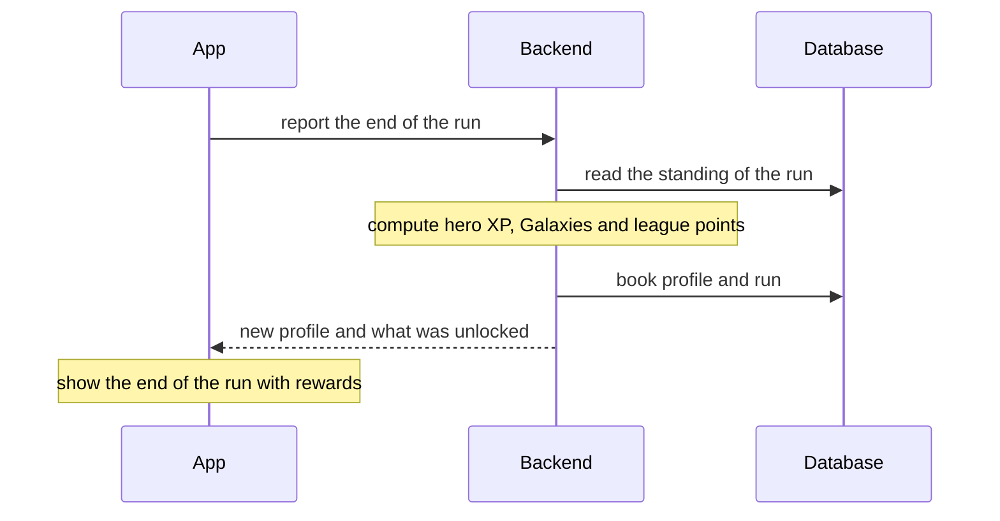
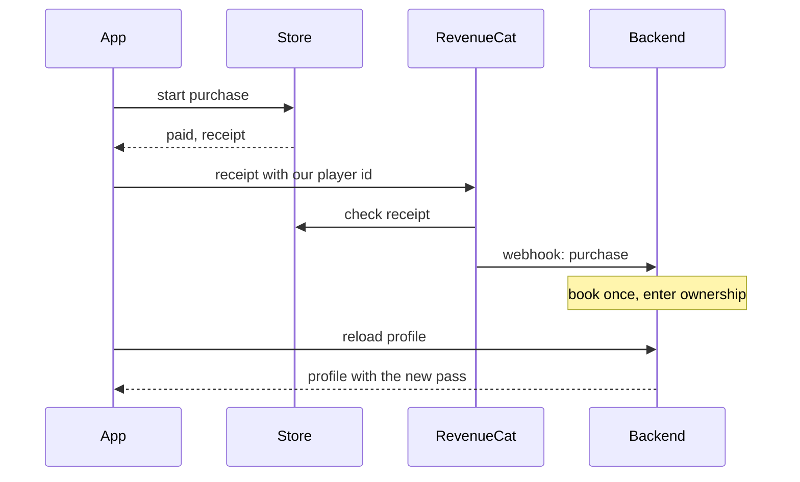
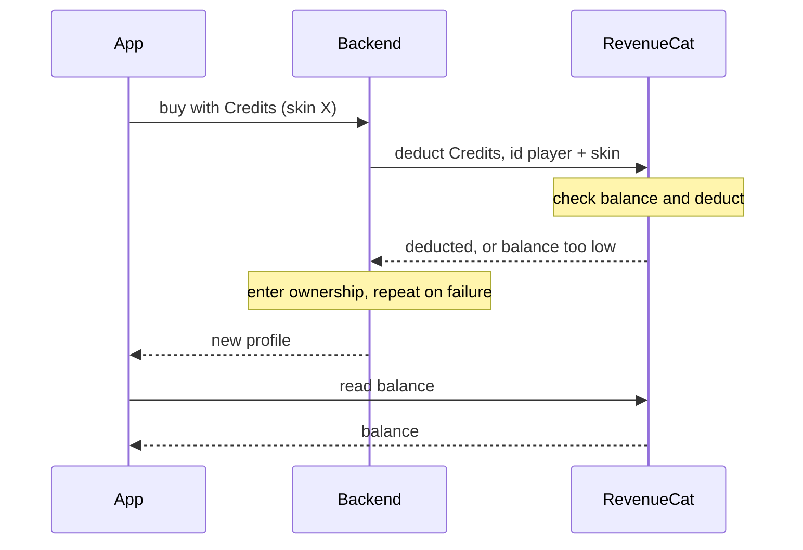
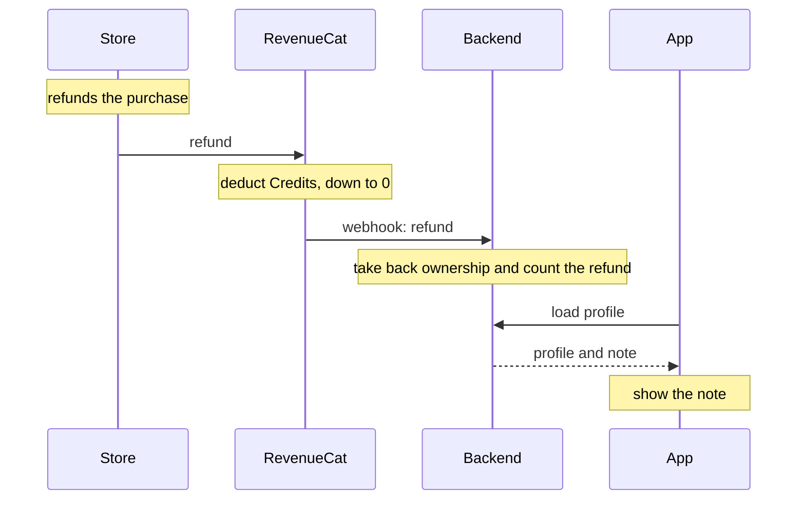

# Client and server: communication and flows

Concept only (decided 2026-11-17). The only built part is the seam in the client, `OpponentSource` (`apps/client/src/opponents.ts`). Paths, field names, error codes and the action codes below are naming proposals; what is fixed is which requests exist and what they carry.

This is the reference for how the app, the backend and the outside services talk to each other. Related concepts: [matchmaking.md](matchmaking.md) (whom you fight), [store.md](store.md) (purchases), [ux.md](ux.md) (screens), [retention.md](retention.md) (progress and economy).

## At a glance

The app has four partners, but only one of them decides about the game. Game Center or Play Games say who the player is. The stores take the money. RevenueCat checks the purchases and keeps the Credits balance. Everything else runs through the backend, and the app keeps only copies that it can reload at any time.

## Decisions

| Topic | State | Source |
| --- | --- | --- |
| The game only starts with a network connection | decided | [matchmaking.md](matchmaking.md) |
| One request per round, right before the fight | decided | [matchmaking.md](matchmaking.md) |
| The server picks opponent and fight seed, the app computes and plays back | decided | [matchmaking.md](matchmaking.md) |
| Silent sign-in through Game Center and Play Games, no guest account | decided | [ux.md](ux.md), 2026-11-17 |
| Purchases through RevenueCat, Credits balance there | decided | [store.md](store.md) |
| Refunded things are taken back, no ban at launch | decided | [store.md](store.md) |
| The server hands out the shop seed per round | decided 2026-11-17 | this document |
| At launch the server checks the backpack for plausibility only | decided 2026-11-17 | this document |
| The app sends the shop actions from the start, the server stores them | decided 2026-11-17 | this document |
| Full replay of the actions on the server | later stage, if the analysis shows outliers | this document |
| The server computes the fight right when matching | decided 2026-11-17 | this document, replaces recomputing at the end of the run |
| Every run request carries the simulation version | decided 2026-11-17 | this document |

## Rules for every request

- **The server decides.** Round, lives, wins, hero XP, Galaxies, league and ownership live on the server. The app keeps a copy for display only.
- **Session token:** every request except the configuration carries the token from sign-in. The player id always comes from the token, never from the request.
- **Versions:** every request names the app version; run requests also name the simulation version. If a version is too old, the server answers "update required".
- **Repeatable:** every request that changes something may be repeated and then returns the same answer. The key is run id + round number for a round, the transaction for a purchase.
- **One run at a time:** a player has at most one open run.
- **Date from the server:** season and daily quests follow the server date, not the clock of the device.
- **Errors:** every error answer carries a fixed code that the app maps to a screen (see "Error cases").
- **Small requests:** a backpack is about 1.3 KB, the actions of a round about 0.5 KB. The server rejects everything that is clearly larger.

## App start and sign-in

The configuration comes first and without sign-in, so that the app can show something sensible when it is too old or the server is in maintenance. Then the player signs in silently through Game Center or Play Games. The backend checks the identity with Apple or Google itself and believes nothing the app says. It hands out its own player id, which is also the id used at RevenueCat, and a session token with a short lifetime. The store id never leaves the backend.

The profile in the answer replaces the local copy completely. The app computes nothing on the profile itself, not even the date for season and quests.

## One round of a run

The first three steps happen once per run, everything from the shop phase on repeats in each of the up to twelve rounds. The app needs no network during the shop phase. Only the Fight button triggers the one request of the round.

**Shop seed from the server.** The app does not roll the offers on its own. The seed for the shop of the round comes from the server, for round 1 with the start of the run and after that with every fight answer. All offers and every reroll of the round follow from the seed. The app records every action of the shop phase.

**Check at launch: plausibility.** The fight request carries the finished backpack and the actions of the round. The server checks the backpack against rules that hold without the history: the items and bags exist, everything lies validly and without overlap, rarity and tier are possible in this round, and the total value fits the gold that can have been earned by then. If something does not fit, it rejects with `invalid_backpack`. The app no longer sends round, wins and lives; the server knows them.

**Store the actions from the start.** The server stores the actions of every round but does not check them at launch. After some weeks the stored runs can be replayed offline to find outliers. If there are any, the replay is switched on inside the request. That is then a change on the server only; app and interface stay the same.

**Commit first, then match.** The server commits the checked backpack before it picks opponent and fight seed. So nobody can fit the backpack to the opponent. The committed backpack is also the possible opponent for others.

**Compute right away.** The server computes the fight inside the request, applies the merges and stores result and new standing. The answer carries opponent, fight seed, the result and the shop seed of the next round. The app computes the same fight with the core to play it back. If it gets a different result, the server's result counts.

**Simulation version.** The start of the run and every fight request name the version of core and data. If it differs from the server's, `update_required` comes back, because app and server would otherwise compute differently.

Until an opponent is there, the app shows the search screen. If no answer comes, the run stays paused before the fight (see "Lost connection").

The core still lacks three things for this: a type for actions with a function that reads and applies one line, the version id from core and data, and reference fights that must give the same result in Node, Chromium and WebKit. The single steps of the shop phase already exist in the core (`buy`, `reroll`, `moveItem` and so on in `packages/core/src/run.ts`), so the action type is mostly a thin layer on top. The client has to make every change through that layer, so that the record is complete.

### Shop actions

Every action is one short line of a code and numbers. That stays readable and is small, because items are addressed by their place in the state and not by their name.

| Action | Line | Example |
| --- | --- | --- |
| Reroll | `rr` | `rr` |
| Pin or unpin an offer | `fz` offer | `fz 2` |
| Buy and place | `by` offer x y rotation | `by 3 4 2 1` |
| Buy and drop as a loose item | `by` offer | `by 3` |
| Move an item | `mi` item x y rotation | `mi 5 1 0 0` |
| Move a bag | `mb` bag x y rotation | `mb 1 0 3 0` |
| Place a loose item | `pl` loose x y rotation | `pl 0 2 3 0` |
| Take an item out of the backpack | `di` item | `di 5` |
| Take a bag out | `db` bag | `db 1` |
| Lock or unlock an item | `lk` item | `lk 5` |
| Sell (item, bag, loose item) | `si`, `sb`, `sl` and the place | `si 5` |
| Take the free artifact | `ts` choice | `ts 1` |

A round is a list of such lines in the order they happened, for example `by 3 4 2 1`, `rr`, `by 0`, `pl 0 2 3 0`, `si 5`. A line has about 5 to 12 characters, so a round with 50 actions is about 0.5 KB. The server accepts only a fixed maximum number of actions per round.

## End of the run and booking

A run ends after twelve rounds, at zero lives or when the player gives up. The app only reports that the run is over and sends no results. The server computed every fight when matching and knows wins and lives. Nothing is recomputed at the end of the run.

Hero XP, Galaxies and league points come from the stored standing. The server books everything in one step and exactly once. If the app reports the end a second time, it gets the same answer and nothing is booked twice.

If the app reports an end the server does not know (the run still has lives and rounds left), that counts as giving up. If the app never reports an end although the run is over on the server, the server books on its own at the next app start.

## Lost connection and continuing

The game runs online only, but a connection may drop at any time without anything being lost or counted twice. The run then stands still and continues at the same place.

| The connection drops | What the server has | What the app does after reconnecting |
| --- | --- | --- |
| during the shop phase | the standing after the last round and the shop seed of the current one | nothing special, the actions of the current round are local |
| after Fight, before the answer | maybe already opponent, seed and result | send the same request again; it gets the same answer |
| while the fight is played back | the result and the new standing | finish the fight locally, no network needed |
| while reporting the end of the run | maybe already booked | report the end again; the answer is the same |
| the app was closed | the open run with standing and shop seed | ask for the open run at start and continue |

For this to work, the answer to a fight request is bound to run and round, not to the single call. A second call for the same round never picks a new opponent, not even with a different backpack. That prevents asking again and again until a weak opponent comes.

Because the server knows the standing after every round and the shop seed, a run can also be continued after a reinstall or on another device. Only the actions of the shop phase in progress are lost. It starts again, with the same offers.

## Purchase for real money

The app talks to the store and to RevenueCat during a purchase, but it unlocks nothing itself. Ownership only comes into being when RevenueCat reports the checked purchase to the backend by webhook. The backend checks where the webhook comes from, books every report only once and enters the ownership with its origin.

Seconds can pass between paying and the webhook. During that time the app shows "Confirming purchase" and reloads the profile until the ownership is there. If it does not come, the purchase stays visibly open and the app tries again at the next start. Details: [store.md](store.md).

## Purchase with Credits and earned Credits

The balance lives at RevenueCat only. The app may read it but never change it. Every change goes through the backend, which holds the secret key.

The order is fixed: deduct first, then unlock. Every deduction carries an id made of player and thing, so that a repeated call does not deduct twice. If deducting works but entering the ownership does not, the backend repeats the entry until it stands. If the balance is too low, the backend answers "balance too low" and nothing changes.

Earned Credits (pass tiers, planet track) take the same way in the other direction. The backend credits them at RevenueCat when it books the run, with an id per reward, so that every tier pays only once. Bought Credit packs are credited by RevenueCat itself as soon as the store confirms the purchase.

## Refund

A refund always starts outside the app. RevenueCat reports it by webhook, the backend takes the bought thing back and counts the refund on the account. Nobody is banned at launch.

For refunded Credit packs RevenueCat deducts the Credits itself, but never below zero. If the Credits are already spent, a gap remains. How the backend closes it is not decided yet (see [store.md](store.md)). If a skin that is taken back was equipped, the backend resets to the default. The app shows a short note at the next load.

## Interfaces

All requests except the configuration and the webhook need the session token.

| Request | When | Sends | Gets | Repeatable |
| --- | --- | --- | --- | --- |
| `GET /config` | app start, before sign-in | app version | minimum version, season, server date, maintenance | yes |
| `POST /session` | app start, token expired | signed identity from Game Center or Play Games | session token, profile | yes |
| `GET /profile` | after a purchase, after returning to the app | nothing | profile (ownership, league, pass, quests) | yes |
| `POST /profile/equip` | change the profile | picture, name, background, skin per hero | profile | yes |
| `GET /runs/current` | app start | nothing | open run with standing and shop seed of the round, or nothing | yes |
| `POST /runs` | start a run | hero, simulation version | run id, shop seed for round 1 | yes, while a run is open the same one comes back |
| `POST /runs/{id}/rounds/{n}/fight` | Fight button | backpack, actions of the round, simulation version | opponent backpack, name, league patch, fight seed, result, shop seed of the next round | yes, same answer per run and round |
| `POST /runs/{id}/finish` | end of the run or giving up | reason (finished, gave up) | rewards, profile | yes, same answer |
| `POST /shop/buy` | purchase with Credits | thing | profile or "balance too low" | yes, deducts only once |
| `POST /hooks/revenuecat` | RevenueCat reports a purchase or a refund | event from RevenueCat | confirmation | yes, every event counts once |
| `GET /account/export`, `DELETE /account` | settings | nothing | the player's data, or confirmation of the deletion | yes |

Three things do not run through the backend: the silent sign-in at Game Center or Play Games, the real-money purchase in the store with its report to RevenueCat, and reading the Credits balance at RevenueCat.

## Error cases

Every error answer carries a fixed code by which the app decides what to show. The text for the player comes from the app's language files and never from the server.

| Case | How the app sees it | What the app does |
| --- | --- | --- |
| no network | the request does not get through | show a note, the run stays paused, retry on its own |
| maintenance | configuration or code `maintenance` | maintenance screen, no run can be started |
| app too old | minimum version in the configuration or code `update_required` | update screen with a way to the store |
| not signed in | Game Center or Play Games give no identity | note that the game needs the sign-in |
| token expired | code `unauthorized` | sign in again silently and repeat the request |
| run or round does not fit | code `run_conflict` | get the open run from the server and show its state |
| backpack is rejected | code `invalid_backpack` | error note, the run stays paused before the fight |
| balance too low | code `insufficient_credits` | read the balance again, show the way to the Credit packs |
| purchase not confirmed yet | the profile does not hold the ownership yet | show "Confirming purchase", load the profile again |
| too many requests | code `rate_limited` | wait and repeat, without a message to the player |

The screens for no network, maintenance and update are still missing in [ux.md](ux.md) and have to be described there first.

## Open questions

- How does the backend close the gap when refunded Credits are already spent?
- How long is a session token valid, and how long may a run stay paused?
- Which request limits apply per player?
- How many actions may a shop phase have at most, and how long are the records kept?
- After how many weeks are the records analysed, and from which finding on is the replay switched on?
- What happens to open runs when an update changes the simulation version?
- At RevenueCat unchecked: request limits and the exact error code when the balance is too low.
