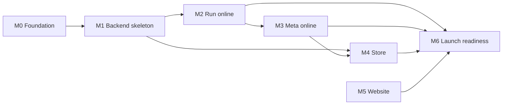

# Requirements for version 1

Draft from 2026-11-17, to be walked through together before issues are cut.

This document says what has to hold when version 1 launches. It is the source of truth for the target state. It does not explain the concepts again; every requirement points to the document that does.

## How to use this document

- **One line per requirement.** Each has a fixed id (`RUN-04`). Ids never change and are never reused; a dropped requirement keeps its id and is marked as dropped.
- **State** says how firm a requirement is: `decided` (decided by the designer), `proposal` (suggested, not confirmed yet), `open` (needs a decision before it can be built).
- **Open points come in two kinds.** `needs designer` marks a point about the game or about money; only the designer decides it, and its issue starts with getting that decision. `technical` marks a point that the planning of its issue may settle with a proposal. Every launch blocker needs the designer.
- **Whether something is built is not tracked here.** That changes all the time and lives in the issues.
- **Issues are cut from this document.** An issue names the ids it covers. Before an issue is written, the code is checked for what already exists, so the issue describes only the difference. Requirements in state `open` do not become issues until they are decided.
- **A concept changes first, then this document, then the code.** If a concept document and this document disagree, that is a mistake to fix, not a choice.

## Scope of version 1

In version 1:

- The game as it is designed today: 4 heroes plus the season hero, runs of 12 rounds, the shop, merges, fights against stored backpacks.
- Online only, with an account through Game Center or Play Games.
- Progress: hero levels, planet track, season pass (free and premium), 10 leagues.
- Daily and weekly quests.
- Purchases for real money and with Credits.
- English and German.
- A website with the legal pages and a landing page.
- Launch on one platform first, probably Android. iOS stays buildable and follows.

Not in version 1 (decided or postponed):

| Topic | Why |
| --- | --- |
| Push notifications | decided: not in version 1 |
| Guest account, own login | decided against |
| Progress that moves between iOS and Android | decided against, see [ux.md](ux.md) |
| Offline mode | decided against, see [matchmaking.md](matchmaking.md) |
| Guided first run | decided against |
| Account ban after many refunds | idea for later, see [store.md](store.md) |
| Full replay of the shop actions on the server | later stage, see [client-server.md](client-server.md) |
| Backpack score, loading the opponent in the background | postponed, see [matchmaking.md](matchmaking.md) |
| Vibration | decided against, see [ux.md](ux.md) |

## Milestones

| Milestone | Goal | Depends on |
| --- | --- | --- |
| M0 Foundation | The repo checks itself on every change, and the core has what the server needs. | – |
| M1 Backend skeleton | A backend that runs locally and in the cloud, with sign-in and the profile on the server. | M0 |
| M2 Run online | A whole run is played against the backend, with bot opponents. | M1 |
| M3 Meta online | Leagues, season, pass, planet track and quests are booked by the server. | M2 |
| M4 Store | Purchases for real money and with Credits, refunds. | M1, for pass and skins also M3 |
| M5 Website | Legal pages and landing page are online. | – (needs the provider for the final texts) |
| M6 Launch readiness | Everything that stands between a working game and the store release. | M2, M3, M4, M5 |

M5 has no technical dependency and can run beside everything else. Art (items, heroes, planets, skins) also runs beside the milestones and is collected in M6.

## Quality and tests

| Id | Requirement | Source | Milestone | Depends on | State |
| --- | --- | --- | --- | --- | --- |
| QA-01 | Code and its tests are written together. A change without tests for its new behaviour is not finished. | designer, 2026-11-17 | M0 | – | decided |
| QA-02 | Every pull request runs `validate`, `typecheck`, the linter and all tests automatically. It is merged only when everything is green. | review | M0 | – | decided |
| QA-03 | The repo has one linter and one formatter setup (ESLint, Prettier) that all packages share. | review | M0 | – | decided |
| QA-04 | Three test levels: unit tests for core and backend; interface tests against the locally started backend; a few browser runs of the client. | designer, 2026-11-17 | M0 to M2 | DEV-01 | decided |
| QA-05 | Browser runs cover only what is necessary: start, one whole round, end of a run, one purchase. They run in Chromium and WebKit. | designer, 2026-11-17 | M2 | QA-04 | decided |
| QA-06 | Reference fights give exactly the same result in Node, Chromium and WebKit. A difference fails the build. | [client-server.md](client-server.md) | M0 | CORE-03 | decided |
| QA-07 | Before every release a short written checklist is run by hand on a real phone, for what browser tests cannot show: sign-in, purchase, safe area, performance, app start without network. | this document | M6 | – | decided |
| QA-08 | No dependency with a known serious vulnerability. `zod` is updated before the backend uses it for input checks. | review | M0 | – | decided |

Browser runs say a lot, but not everything. The client is a web app inside a web view; on Android that web view is Chromium, on iOS it is WebKit. So game logic and screens are tested meaningfully in those two browsers. The native parts are not: sign-in, purchases, the safe area on real devices and speed on weak phones. That is what QA-07 is for.

## Local development and environments

| Id | Requirement | Source | Milestone | Depends on | State |
| --- | --- | --- | --- | --- | --- |
| DEV-01 | The whole system starts locally with documented commands: client, backend and database. No cloud account is needed for that. | designer, 2026-11-17 | M1 | – | decided |
| DEV-02 | Locally a small HTTP server wraps the same Lambda handlers that run in the cloud. There is no second implementation for local use. | designer, 2026-11-17 | M1 | BE-01 | decided |
| DEV-03 | Locally the database runs in a container (the local version of DynamoDB). | designer, 2026-11-17 | M1 | BE-04 | decided |
| DEV-04 | Purchases can be tried locally without a real store. First choice is RevenueCat's test store; if that does not fit, a stand-in behind the same interface. | designer, 2026-11-17 | M4 | – | open: check what RevenueCat offers (technical) |
| DEV-05 | Locally and in browser tests a development identity replaces Game Center and Play Games. It exists only in development builds and is refused by the test and production backends. | this document | M1 | ACC-02 | decided |
| DEV-06 | A command fills a local or test database with bot players and their backpacks. Local and test need only a small set, not the full launch amount. | [matchmaking.md](matchmaking.md) | M2 | MM-03 | decided |
| DEV-07 | Three environments: local, test (cloud) and production (cloud). Test and production are fully separate (data, keys, RevenueCat project). | designer, 2026-11-17 | M1 | – | decided |
| DEV-08 | No secret is in the repo or in the app. Each environment gets its settings from outside; in the cloud secrets are kept in the AWS Parameter Store. | review | M1 | – | decided |

## Core

| Id | Requirement | Source | Milestone | Depends on | State |
| --- | --- | --- | --- | --- | --- |
| CORE-01 | The core stays deterministic and free of Node and browser APIs. Client and server use the same core. | `CLAUDE.md` | – | – | decided |
| CORE-02 | Every change of the shop phase is one action that the core reads from a short line and applies. The client changes the run only through actions and records them. | [client-server.md](client-server.md) | M0 | – | decided |
| CORE-03 | The core gives out a simulation version made from core and data. Two builds with the same version compute the same fight. | [client-server.md](client-server.md) | M0 | – | decided |
| CORE-04 | The shop of a round follows completely from a seed that the caller passes in. | [client-server.md](client-server.md) | M0 | – | decided |
| CORE-05 | The core has a plausibility check for a backpack of a given round (items exist, layout valid, rarity and tier possible, value fits the gold earned so far). | [client-server.md](client-server.md) | M2 | – | decided |
| CORE-06 | The season reset follows the league groups (core, `data/meta.json`, glossary text). | [matchmaking.md](matchmaking.md) | M3 | – | decided |
| CORE-07 | The core can play a run with special rules, as the quests need them. | [retention.md](retention.md) | M3 | META-07 | decided, rules open (needs designer) |
| CORE-08 | The data version (major.minor) is part of the data and decides whether a stored backpack can still be matched. | [matchmaking.md](matchmaking.md) | M2 | – | decided |

## Account and profile

| Id | Requirement | Source | Milestone | Depends on | State |
| --- | --- | --- | --- | --- | --- |
| ACC-01 | Sign-in is silent through Game Center (iOS) or Play Games (Android). There is no own login and no guest account. | [ux.md](ux.md) | M1 | – | decided |
| ACC-02 | The backend checks the identity with Apple or Google itself. | [client-server.md](client-server.md) | M1 | BE-01 | decided |
| ACC-03 | The backend gives every player its own random player id. The store identity never leaves the backend. | [client-server.md](client-server.md) | M1 | ACC-02 | decided |
| ACC-04 | Every request carries a session token with a short lifetime. The player id comes from the token only. | [client-server.md](client-server.md) | M1 | ACC-02 | decided, lifetime open (technical) |
| ACC-05 | The profile (ownership, league, pass, hero levels, Galaxies, equipped things) lives on the server. The app keeps only a copy. | [client-server.md](client-server.md) | M1 | ACC-03 | decided |
| ACC-06 | Everything a player can customise is in the profile: picture, name, background, hero skins, league patch. | [ux.md](ux.md) | M3 | ACC-05 | decided |
| ACC-07 | Player names: free text with a filter, or picked from a word list. | review | M3 | – | open (needs designer) |
| ACC-08 | A player can delete the account and get their data from the settings. The website does not delete accounts itself; it states that a deletion request can be sent to the support address. | [client-server.md](client-server.md) | M6 | WEB-01 | decided, check against the store rules (LB-07) |

## Run

| Id | Requirement | Source | Milestone | Depends on | State |
| --- | --- | --- | --- | --- | --- |
| RUN-01 | A run can only be played with a network connection. | [matchmaking.md](matchmaking.md) | M2 | – | decided |
| RUN-02 | A player has at most one open run. | [client-server.md](client-server.md) | M2 | – | decided |
| RUN-03 | The server hands out the shop seed of every round. | [client-server.md](client-server.md) | M2 | CORE-04 | decided |
| RUN-04 | There is exactly one request per round, when the player taps Fight. | [matchmaking.md](matchmaking.md) | M2 | – | decided |
| RUN-05 | The server checks every backpack for plausibility and rejects what cannot be. | [client-server.md](client-server.md) | M2 | CORE-05 | decided |
| RUN-06 | The app sends the shop actions of every round. The server stores them without checking them. | [client-server.md](client-server.md) | M2 | CORE-02 | decided |
| RUN-07 | The server commits the backpack before it picks opponent and seed. | [client-server.md](client-server.md) | M2 | – | decided |
| RUN-08 | The server computes the fight inside the fight request and stores result and standing. The app computes the same fight only to show it. | [client-server.md](client-server.md) | M2 | CORE-03 | decided |
| RUN-09 | Every request of a run can be repeated and returns the same answer. A round never gets a second opponent. | [client-server.md](client-server.md) | M2 | – | decided |
| RUN-10 | At the end of the run the server books hero XP, Galaxies and league points exactly once. Giving up books the reward for the standing reached. | [client-server.md](client-server.md), [ux.md](ux.md) | M2 | – | decided |
| RUN-11 | A run survives a lost connection, a closed app and a reinstall. It continues at the same round. | [client-server.md](client-server.md) | M2 | RUN-03 | decided |
| RUN-12 | A request with a simulation version the server does not accept is answered with "update required". | [client-server.md](client-server.md) | M2 | CORE-03 | decided |
| RUN-13 | It is defined what happens to open runs when an update changes the simulation version. | [client-server.md](client-server.md) | M2 | – | open (technical) |
| RUN-14 | Stored shop actions are kept for a set time and then deleted. | [client-server.md](client-server.md) | M2 | RUN-06 | open: how long (technical) |

## Matchmaking

| Id | Requirement | Source | Milestone | Depends on | State |
| --- | --- | --- | --- | --- | --- |
| MM-01 | An opponent is searched by round, then run standing, then league, relaxing step by step. The round is never relaxed. | [matchmaking.md](matchmaking.md) | M2 | – | decided |
| MM-02 | Never the player's own backpack, no opponent twice in a run, only backpacks valid under the player's data version. | [matchmaking.md](matchmaking.md) | M2 | CORE-08 | decided |
| MM-03 | At launch there are 50 bot backpacks per round and run standing (2,100), made by invented bot players with name, league group and patch. | [matchmaking.md](matchmaking.md) | M2 | – | decided, number of bot players open (technical) |
| MM-04 | Bot backpacks live in the backend and can be replaced without an app update. | [matchmaking.md](matchmaking.md) | M2 | – | decided |
| MM-05 | Player backpacks are stored from the first day but handed out as opponents only after the numbers are evaluated. | [matchmaking.md](matchmaking.md) | M2 | – | decided |
| MM-06 | The first 2 to 3 runs of a new player go against easier bot backpacks. | [matchmaking.md](matchmaking.md) | M2 | MM-03 | decided |
| MM-07 | The opponent is shown only in the fight, with name and league patch. | [ux.md](ux.md) | M2 | – | decided |

## Progress, season and quests

| Id | Requirement | Source | Milestone | Depends on | State |
| --- | --- | --- | --- | --- | --- |
| META-01 | Hero levels, planet track and season pass work as described and are booked by the server. | [retention.md](retention.md) | M3 | RUN-10 | decided |
| META-02 | 10 leagues with league points after every run. A reached league is a floor. New players start in the lowest league with 0 points. | [retention.md](retention.md), [ux.md](ux.md) | M3 | RUN-10 | decided |
| META-03 | The season follows the server date. At the season change the server hands out the league patch, applies the reset and starts the new pass. | [retention.md](retention.md) | M3 | CORE-06 | decided |
| META-04 | Season pass with a free and a premium lane. The premium lane gives the season hero from level 1. | [retention.md](retention.md) | M3 | – | decided |
| META-05 | Version 1 ships with a season hero. | hero design in progress | M3 | – | decided, hero open (needs designer) |
| META-06 | Daily and weekly quests are reached through one entry point. They are whole runs with special rules and give Galaxies. | [ux.md](ux.md), [retention.md](retention.md) | M3 | CORE-07 | decided, contents open (needs designer) |
| META-07 | League up after a run is shown as a quiet animation in the screen, hero level up as an animation at the end of the run. | [ux.md](ux.md) | M3 | – | decided |
| META-08 | All numbers of the meta systems are balanced, not placeholders: XP per level, Galaxies per pass level, league points, free Credits. | [retention.md](retention.md) | M6 | – | open (needs designer) |
| META-09 | A season hero of an earlier season can be bought for Credits after its season. Whether it can also be earned later is open. | [retention.md](retention.md), review | after version 1 | – | open (needs designer) |
| META-10 | Season length is fixed. | [retention.md](retention.md) | M3 | – | open (needs designer) |

## Store

| Id | Requirement | Source | Milestone | Depends on | State |
| --- | --- | --- | --- | --- | --- |
| STORE-01 | All purchases run through RevenueCat. The player is known there only by our player id. | [store.md](store.md) | M4 | ACC-03 | decided |
| STORE-02 | Real-money purchases: premium pass of a season and selected skins. | [store.md](store.md) | M4 | – | decided, products open (needs designer) |
| STORE-03 | Ownership is created only by the server, after RevenueCat reported the purchase. Every report is checked for its origin and booked once. | [store.md](store.md) | M4 | ACC-05 | decided |
| STORE-04 | Ownership is stored with its origin (real money, Credits, pass tier, hero level, planet track). | [store.md](store.md) | M4 | ACC-05 | decided |
| STORE-05 | Credits exist at launch. The balance lives at RevenueCat only. | [store.md](store.md) | M4 | STORE-01 | decided |
| STORE-06 | Buying with Credits: the server deducts first and unlocks after. A repeated request never deducts twice. | [store.md](store.md) | M4 | STORE-05 | decided |
| STORE-07 | Earned Credits are credited by the server with a unique id per reward. | [store.md](store.md) | M4 | STORE-05, META-01 | decided |
| STORE-08 | What is refunded is taken back. Refunds are counted per account. Nobody is banned. | [store.md](store.md) | M4 | STORE-04 | decided |
| STORE-09 | It is defined how the server evens out refunded Credits that are already spent. | [store.md](store.md) | M4 | STORE-08 | open (needs designer) |
| STORE-10 | Every cosmetic has one price field in `data/meta.json` (store product or Credits). Shop and purchase popup read only that. | [store.md](store.md) | M4 | – | decided |
| STORE-11 | Dropped (2026-11-17). A thing costs either real money or Credits; no real-money value is shown next to a Credits price. Whether the law asks for it is part of LB-10. | [store.md](store.md) | M4 | STORE-12 | dropped |
| STORE-12 | Products and prices are fixed for the things version 1 starts with: which cost real money, which cost Credits, Credit packs, pass price, hero price. | [store.md](store.md) | M4 | – | open (needs designer) |
| STORE-13 | Every purchase shows a preview and asks for confirmation. The start screen shows no offers. | [ux.md](ux.md) | M4 | – | decided |
| STORE-14 | No restore button as a convenience. Around purchases and refunds only what the stores require is built. Apple requires a way to restore purchases, so this is needed for the iOS release, not for an Android launch. | [store.md](store.md) | M4 | – | decided, check per store |
| STORE-15 | RevenueCat's behaviour is confirmed in a sandbox project before building: server-side deduction, error on low balance, request limits, automatic answer to Apple's refund question. | [store.md](store.md) | M4 | – | decided |

## Client and UX

| Id | Requirement | Source | Milestone | Depends on | State |
| --- | --- | --- | --- | --- | --- |
| UX-01 | Screens, navigation and actions follow [ux.md](ux.md). A new screen or action goes there first. | `CLAUDE.md` | – | – | decided |
| UX-02 | The states no network, maintenance, update required, searching for an opponent and confirming purchase are described in [ux.md](ux.md) and built. | [client-server.md](client-server.md) | M2 | – | decided, screens open (needs designer) |
| UX-03 | The client holds no deciding state. Profile, season date and Credits come from the server. | [client-server.md](client-server.md) | M2 | ACC-05 | decided |
| UX-04 | Every text goes through the language files. English and German are complete. | [i18n.md](i18n.md) | M6 | – | decided |
| UX-05 | Fonts are part of the app and are not loaded from another server. | review, [mobile.md](mobile.md) | M0 | – | decided |
| UX-06 | Development helpers (such as the game handle on `window`) exist only in development builds. | review | M0 | – | decided |
| UX-07 | Outside the safe area the client draws only backgrounds. | [mobile.md](mobile.md) | – | – | decided |
| UX-08 | Settings: language, music, sounds, account, privacy, help, glossary. | [ux.md](ux.md) | M3 | WEB-03 | decided |
| UX-09 | The game has music and sounds, and both can be switched off. | [ux.md](ux.md) | M6 | – | decided, content open (needs designer) |
| UX-10 | Final art replaces the placeholders: items, bags, heroes, skins, planets, league patches, symbols. | [style.md](style.md), [item-art.md](item-art.md) | M6 | – | decided |

## Backend and operations

| Id | Requirement | Source | Milestone | Depends on | State |
| --- | --- | --- | --- | --- | --- |
| BE-01 | The backend is TypeScript and serverless (AWS Lambda). It lives in this repo and uses the core as a package. | designer, 2026-11-17 | M1 | – | decided |
| BE-02 | The cloud setup is described as code in the repo and can be rolled out to test and production the same way. | review | M1 | – | decided (AWS CDK) |
| BE-03 | Region and services: one European region; HTTP API in front of the Lambdas. | review | M1 | – | decided (Frankfurt) |
| BE-04 | Data is stored in DynamoDB. | designer, 2026-11-17 | M1 | – | decided |
| BE-05 | Every request is checked against a schema before anything else happens: fields, types, size. | review | M1 | QA-08 | decided |
| BE-06 | Request limits per player and per address protect the backend. | review | M2 | – | decided, numbers open (technical) |
| BE-07 | The configuration request carries minimum version, season, server date and a maintenance switch that can be set without a deployment. | [client-server.md](client-server.md) | M1 | – | decided |
| BE-08 | Each Lambda may reach only what it needs. Secrets are kept in the AWS Parameter Store (chosen for cost), not in code or settings files. | review | M1 | – | decided |
| BE-09 | Logs are structured and carry the player id but no names or store identities. | review | M1 | – | decided |
| BE-10 | Usage numbers (players per day, runs, purchases) come from our own logs and data. No analytics kit of another company in the app at launch. Numbers the stores provide out of the box may be used in addition. | designer, 2026-11-17 | M6 | BE-09 | decided |
| BE-11 | Alarms report when errors, response times or cost leave their normal range. | review | M6 | – | decided |
| BE-12 | The database can be restored to a point in time. The table design is made with restoring in mind (what belongs together is restored together). Restoring has been tried once before launch. | review | M6 | – | decided |
| BE-13 | Merging to the main branch rolls out to test automatically. Production is rolled out by a deliberate step. | this document | M1 | QA-02, BE-02 | decided |
| BE-14 | Timed jobs exist for the season change and for deleting old shop actions. | [client-server.md](client-server.md) | M3 | – | decided |
| BE-15 | The app reports crashes and errors of the client. | designer, 2026-11-17 | M6 | – | decided, service open (technical) |

## Website

| Id | Requirement | Source | Milestone | Depends on | State |
| --- | --- | --- | --- | --- | --- |
| WEB-01 | A static website lives in this repo as its own module and is hosted at AWS. | designer, 2026-11-17 | M5 | – | decided |
| WEB-02 | It has a landing page that advertises the game with art and links to the stores. | designer, 2026-11-17 | M5 | – | decided |
| WEB-03 | It has imprint, privacy policy and terms of use. The app links to them from the settings. | designer, 2026-11-17 | M5 | LB-01, LB-02 | decided |
| WEB-04 | It has a support contact and states that an account deletion request can be sent to that address (see ACC-08). | this document | M5 | ACC-08 | decided |
| WEB-05 | English and German, built so that another language is easy to add. | this document | M5 | – | decided |
| WEB-06 | It uses the look of the game (`data/theme.json`, [style.md](style.md)) and loads nothing from other servers. | this document | M5 | – | decided |
| WEB-07 | A domain is registered and set up. | designer, 2026-11-17 | M5 | – | open (needs designer) |

## Launch blockers

These are not features. Each of them stops the release until it is done, and most need the designer, not code.

| Id | Blocker | State |
| --- | --- | --- |
| LB-01 | It is decided who the provider is (a person or a company). The name goes into the imprint, the stores and the contracts. | open |
| LB-02 | Imprint, privacy policy and terms of use are written and legally checked. The terms cover taking things back after a refund. | open |
| LB-03 | The domain exists (see WEB-07). | open |
| LB-04 | Store developer account for the launch platform, with tax and payout details. | open |
| LB-05 | The app id is final. It cannot change after the first upload ([mobile.md](mobile.md)). | open |
| LB-06 | Signing keys exist and are stored safely outside the repo. | open |
| LB-07 | Store listing: name, texts in both languages, icon, screenshots, age rating, the store's data safety form. Check whether the store asks for a web address for account deletion requests; if so, a page that names the support address has to be enough (ACC-08). | open |
| LB-08 | RevenueCat account and the store products are created; one real test purchase and one refund went through. | open |
| LB-09 | Contracts for data processing with every service that sees player data (AWS, RevenueCat, crash reports). | open |
| LB-10 | Legal check of the store concept: right of withdrawal, the pass, and whether a real-money value has to be shown next to Credits prices (dropped as a feature, STORE-11). | open |
| LB-11 | The name "Backpack Space" is checked for conflicts (trademarks, store search). | decided |
| LB-12 | Google Play may ask new developer accounts for a closed test with a number of testers over some days before a release. Check the current rule and plan the time. | check |
| LB-13 | App icon and start picture replace the Capacitor defaults. | open |
| LB-14 | Final art is in (UX-10), music and sounds are in (UX-09). | open |
| LB-15 | Meta numbers are balanced (META-08). | open |
| LB-16 | A load test of the fight request and a restore of the database were done (BE-12). | decided |
| LB-17 | A support address exists and someone reads it. | open |

## Open decisions

Requirements in state `open` wait for one of these:

| Topic | Affects |
| --- | --- |
| Provider: person or company | LB-01, LB-02, WEB-03 |
| Launch platform: Android first? | LB-04, QA-07 |
| Player names: free text with a filter or a word list | ACC-07 |
| Quest contents: which special rules, how many per day and week | META-06, CORE-07 |
| Season length, pass price, Credit packs, skin and hero prices | META-10, STORE-12 |
| Season hero of season 1 | META-05 |
| Can a season hero be earned by everyone after its season | META-09 |
| Meta numbers | META-08 |
| How to even out refunded Credits that are spent | STORE-09 |
| Session lifetime, how long a run may stay paused, request limits | ACC-04, BE-06 |
| How long shop actions are kept, and when they are analysed | RUN-14 |
| Open runs after an update of the simulation version | RUN-13 |
| Number and spread of bot players | MM-03 |
| Crash report service | BE-15 |
| Domain | WEB-07 |
| Local purchase testing | DEV-04 |
