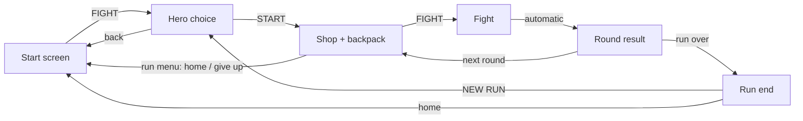

# UX: flows, navigation, screens and actions

Status: 2026-11-17. Ilja decided all open questions of the first draft on that day. **Decided** marks his decisions; *assumption* marks what the client does today without an explicit decision; **open** marks what is still to settle. Built = in `apps/client` (structure of every screen below is built; placeholders are named in the State column).

Related: game rules in `docs/concept.md`, meta progress in `docs/retention.md`, colours and buttons in `docs/theme.md`, safe area in `docs/mobile.md`.

## Principles

The game should feel like a game, not like an admin tool: symbols instead of text, explanations only on request.

**Screen and layout**

- Portrait, drawing area 390 wide, 750–900 high depending on the device; everything must fit into 750. **Decided**
- The status bar, notch, camera island and home indicator show only background, no data and no buttons. **Decided** (2026-11-17)
- The main action sits at the bottom within thumb reach, status at the top. Back at the top left, close (X) at the top right. *Assumption*

**Language of the interface**

- Little text, many symbols. A symbol means the same thing everywhere. **Decided**
- Item and hero info opens as a popup on tap (not on drag). An "i" button at the top of the popup explains exactly the symbols and terms of that popup and links to the glossary. **Decided**
- The glossary is a place of its own for all terms; it lives in the settings popup. **Decided**
- English and German; no text is hard-coded. **Decided**

**Colours** (`data/theme.json`): yellow = main action and reward (Start, Fight, Take, Galaxies); light blue = selection and info; green and red only for results (win, loss, not enough Energy). **Decided**

**Gestures**

| Gesture | Effect |
| --- | --- |
| Tap | select, press a button, open the popup of an item or hero |
| Drag | buy, place, move, sell (onto the bin) |
| Second finger while dragging | turn the item |
| Swipe in a long popup | scroll |
| Tap beside a popup | close the popup |

**Feedback**

- Short toasts above the bottom row, about 2 s ("Not enough gold", "Does not fit"). *Assumption*
- Rewards are booked automatically; there is no claim button. *Assumption* (`docs/retention.md`)
- **No vibration** anywhere in the app. **Decided** (2026-11-17). Sound and music: **open**.

## Navigation

The start screen is the only hub: from there into a run and into every meta popup. Inside a run the way only goes forward (shop, fight, result) until the run is over or the player leaves through the run menu.

Popups outside a run: progress (5 tabs), hero popup, settings with glossary, Credits shop, quests. Popups inside a run: item popup → "i" legend → glossary, recipe radar, free pick, backpack numbers, introduction, fight details, run menu.

## Flows: the run

A run is a loop of shop, fight and result: 12 rounds, or until the 4 lives are gone.

**F1 Start a run**

1. Start screen: big FIGHT button.
2. Hero choice: heroes on a ring, the chosen hero large on top with level. Tap a hero to choose it. The ring is fixed up to 8 places and turns once there are more. **Decided** (2026-11-17)
3. The round START button in the middle starts the run and leads to the shop, round 1.
   - Hero not owned: the middle button becomes a shop button and leads to that hero in the Credits shop. **Decided**
   - "Coming soon" place: a question mark, no action.
4. First run only: a short introduction in the shop (spots with symbols and one line; tap = next, X = skip). It can be replayed with the "i" button in the shop.

**F2 Shop round (core loop)**

1. The shop opens with a note on this round's health.
2. Buying = dragging an offer: into a bag (placed) or anywhere else (it drops loose below the backpack). **Decided**
   - An offer shows the item at its backpack size (one cell as in the grid), only shrunk when it does not fit its card; an item with a picture shows the picture alone, without a tile or frame around it. **Decided** (2026-11-18)
3. Rebuild: drag items and bags in the backpack, turn with a second finger; a bag takes its contents along.
4. Sell: drag onto the bin (the price shows while dragging) or use the item popup.
5. Reroll (1 gold) for new offers; pinned offers stay, also into the next round.
6. Merging: matching neighbours glow and an energy beam joins them. They merge automatically after the fight. Locking in the item popup prevents it. **Decided**
7. Numbers: the row with health and Energy; the chart button opens all backpack numbers.
8. FIGHT starts the fight; it is blocked while a free pick is open.
9. Opponent: not shown in the shop; it appears in the fight, with name and league patch. **Decided** (2026-11-17)

**F3 Fight**

1. Opponent on top, own backpack below, the dying star between them as the clock.
2. The core has already computed the fight; the client only plays it back. Speed ×1, ×2, ×4, no skipping. **Decided**
3. At the end it goes to the round result on its own.

**F4 Round result**

1. Victory or defeat, hearts (a life is lost on defeat), the three strongest items.
2. Chart button: damage by source for both sides.
3. CONTINUE: back to the shop of the next round, or to the run end when the run is over.
4. If something merged, the shop shows the new item once as a popup plus a toast.

**F5 Free pick after rounds 2 and 6**

1. On entering the shop after round 2 (and 6) the pick opens over the shop. **Decided**
2. Round 2: two of the three hero items (hero badge on top). Round 6: three general artifacts (star on top). Nothing says why an item is missing. **Decided**
3. Tap a card = choose, "i" = item popup, TAKE = take it. The item drops loose below the backpack.

**F6 Run end**

1. Summary: Galaxies (wins + lives left), final backpack, hero XP and level, league points, what was unlocked.
2. A new hero level is shown as an animation on this screen. A league promotion is a subtle animation in the view itself, probably without a full-screen moment; the exact form is still to try out. **Decided** (2026-11-17)
3. Actions: NEW RUN (to the hero choice), home, share (not built). **Decided** (2026-11-17): NEW RUN goes to the hero choice, not straight into the shop.

**F7 Leave and resume**

1. The run is stored on the device. Closing and reopening the app continues in the shop or in the running fight (same outcome).
2. **Run menu** behind a small button at the top of the shop: settings, home (pauses the run) and give up (ends the run with the current state and books the reward). **Decided** (2026-11-17)
3. A paused run: the big button on the start screen reads CONTINUE and leads back into the shop. *Assumption*
4. Giving up needs a second tap on the same row (no dialog). *Assumption*

## Flows: progress and meta

Everything between runs starts on the start screen.

**M1 First start**

1. The app opens on the start screen with the starting planet as background.
2. A new player starts in the lowest league with 0 points. **Decided** (2026-11-17) Leagues, pass and quests are there from the start. *Assumption*
3. First run with the introduction in the shop (F1, step 4).

**M2 Reward after a run**

1. The run end books everything automatically: Galaxies, hero XP, league points.
2. Steps reached (hero level, pass level, planet, league) show on the run end as unlocked, with the animations from F6.

**M3 Look at progress**

One popup with five tabs; every entry opens the matching tab:

| Entry | Tab |
| --- | --- |
| Player picture on the start screen | Profile |
| League patch on the start screen | Leagues |
| Galaxies counter | Planets |
| Pass button at the bottom | Season pass |
| Level circle in the hero choice | Hero levels |

**M4 Customise (profile)**

Everything the player customises lives in the profile: player picture, player name, menu background, hero skins and the league patch. **Decided** (2026-11-17) Tap a patch or a background to wear it; the start screen changes at once.

**M5 Season pass**

1. Two columns per level: free and premium. Premium is locked until bought.
2. Tapping premium leads to the purchase (today a "later" toast).
3. Season hero: in the premium pass from level 1, otherwise later for Credits. **Decided**

**M6 Season change**

1. On start the client checks whether a new season has begun.
2. Then: the patch of the old season is booked, 2 leagues down, a new pass. **Decided** (rules). Shown subtly like a league promotion. *Assumption*

**M7 Credits shop** (structure built; what is on sale, prices and paying are open, BUY shows a toast)

1. Entries: cart button at the bottom, Credits counter, middle button of a hero not owned.
2. Contents: skins, backgrounds, grid backgrounds, premium pass, heroes of earlier seasons, Credit packs. **Decided** (`docs/retention.md`)
3. Every purchase shows a preview and asks for confirmation, for Credits and for real money alike. **Decided** (2026-11-17)
4. No offers on the start screen for launch; the shop is reached through the cart button and the Credits counter. **Decided** (2026-11-17, replaces the earlier "start screen as shop window")

**M8 Daily and weekly quests** (structure built with placeholder cards: 3 daily, 1 weekly)

1. One entry point for both, a button in the bottom row of the start screen. **Decided** (2026-11-17)
2. Every quest is a whole run, maybe shorter or longer than a normal one, always with special rules; rewards are Galaxies. **Decided** Which quests and rules: **open**.

**M9 Settings**

The gear button: language, music, sounds, account, privacy, help and the glossary. No vibration setting, because the app never vibrates. **Decided** (2026-11-17) Music and sounds are switches without sound yet; account, privacy and help are placeholders.

**M10 Account**

No sign-in screen. Progress is bound silently to Game Center (iOS) or Google Play Games (Android). There is no own login, so progress does not move between iOS and Android. **Decided** (2026-11-17)

**M11 Start and connection**

1. On start the app asks the server for its configuration, signs in silently and loads the profile from the server (backend.md). While that runs, the screen stays dark; it takes a moment only.
2. If something keeps the player out, one screen (V9) says what and why, with one button TRY AGAIN: maintenance (with the server's text if it names one), update needed (old app), no connection, not signed in (Game Center / Play Games refused or not signed in). **Assumption** (2026-11-18) A store link for "update needed" comes when the store entries exist.
3. Otherwise the start screen opens as before; the season date comes from the server.
4. Development builds sign in as a development player (`?player=player-2` picks another one). Without a backend address the app plays offline with the profile on the device (hosted preview).

## Screens and popups

A screen replaces the previous one. A popup lies on top; X or a tap beside it closes it.

| ID | Name | Kind | Purpose | Contents | State |
| --- | --- | --- | --- | --- | --- |
| V1 | Start screen | screen | hub | planet background, player picture with level and name, league patch, Galaxies, Credits, FIGHT; bottom row: quests, pass, shop, settings | built |
| V2 | Hero choice | screen | choose a hero, start a run | back, Galaxies, Credits, hero picture with level, name, 3 trait symbols + "i", ring of heroes, START or SHOP in the middle | built |
| V3 | Shop + backpack | screen | buy, pack, prepare | hero, lives, round, gold; 6 offers with pins; backpack grid; loose items; health/Energy row + chart; reroll, FIGHT, bin; run menu button | built |
| V4 | Fight | screen | play the fight back | opponent on top with name and patch, star clock, own backpack below, health and Energy bars, speed ×1/×2/×4 | built (name is a placeholder; the patch shows the player's league) |
| V5 | Round result | screen | outcome of the round | victory/defeat, hearts, top 3 items, chart, CONTINUE | built |
| V6 | Run end | screen | summary and reward | Galaxies, final backpack, XP and level (animated), league points (animated), unlocks, NEW RUN, home, share | built |
| V7 | Credits shop | screen | buy | sections: offers, skins, heroes, backgrounds, Credits | built (prices "?") |
| V8 | Quests | screen | daily and weekly | list with progress and reward; starts a run with special rules | built (placeholder cards) |
| V9 | Status | screen | maintenance, update needed, no connection, not signed in (M11) | symbol, title, one sentence, TRY AGAIN | built (no store link yet) |
| P1 | Item popup | popup | what an item does | picture, name, symbol rows, "i", recipe radar; in the backpack: turn, sell, lock | built |
| P2 | Hero popup | popup | what a hero does | passive as symbol rows, paths, "i" | built |
| P3 | "i" legend | popup | explain this popup's symbols | symbol + term + sentence, link to the glossary | built |
| P4 | Recipe radar | popup | recipes of an item | all recipes as symbol rows; tap opens that item | built |
| P5 | Free pick | popup (blocking) | hero item or artifact | 2 or 3 cards, "i", TAKE | built |
| P6 | Backpack numbers | popup | numbers of the backpack | health, Energy, waiting, damage per second, healing, Shield, melee/ranged | built |
| P7 | Fight details | popup | damage by source | both sides side by side | built |
| P8 | Introduction | overlay | first run | spot, symbols, one line, dots, X | built |
| P9 | Progress | popup with 5 tabs | hero levels, planets, pass, leagues, profile | per tab a track with steps and reward tiles, "i"; profile holds everything to customise | built (placeholder rewards) |
| P10 | Glossary | popup (from settings and "i") | all terms | groups, scrolls | built |
| P11 | Settings | popup | options | language, music, sounds, account, privacy, help, glossary | built (music and sounds without sound; account, privacy, help placeholders) |
| P12 | Purchase | popup | confirm a purchase | preview, price, BUY | built (BUY shows a toast) |
| P13 | Run menu | popup | leave a run | settings, home, give up | built |

## Actions

Every action has one gesture and one visible response; what is not possible is explained by a short toast instead of a dialog.

| Where | Action | Gesture | Result | When it is not possible |
| --- | --- | --- | --- | --- |
| V1 | Fight | tap FIGHT | hero choice | – |
| V1 | Profile, leagues, planets, pass | tap picture, patch, Galaxies, pass | progress on the matching tab | – |
| V1 | Shop | tap cart or Credits | Credits shop | – |
| V1 | Quests | tap quests | quests | starting a quest: today a toast |
| V1 | Settings | tap gear | settings (glossary inside) | – |
| V2 | Choose a hero | tap on the ring | picture, name, level change | – |
| V2 | Explain the hero | tap "i" | hero popup | – |
| V2 | Start a run | tap START | shop, round 1 | – |
| V2 | Buy a hero | tap SHOP (middle) | Credits shop at the heroes | – |
| V2 | Back | tap arrow | start screen | – |
| V3 | Buy and place | drag an offer into a bag | bought, in the backpack | "Not enough gold", "Does not fit" |
| V3 | Buy loose | drag an offer below the shop | bought, lies loose | "Not enough gold", "Too many loose" (from 6) |
| V3 | Move | drag an item or bag | new place; a bag takes its contents | snaps back, "Does not fit" |
| V3 | Take out | drag out of the backpack | lies loose | – |
| V3 | Turn | second finger while dragging, or turn button in the item popup | turned by 90° | "No room to turn" |
| V3 | Sell | drag onto the bin, or in the item popup | gold back, price shown while dragging | "Only empty bags" |
| V3 | Pin | tap the pin on an offer | stays through rerolls and into the next round | – |
| V3 | Reroll | tap dice | 6 new offers, 1 gold | "Not enough gold" |
| V3 | Look at an item | tap an item | item popup | – |
| V3 | Lock | LOCK in the item popup | the item does not merge, lock mark | only items with a recipe |
| V3 | Look at a merge | tap the mark between neighbours | popup of the result | – |
| V3 | Numbers | tap health, Energy, chart | toast or backpack numbers | – |
| V3 | Look at the hero | tap the hero badge | hero popup | – |
| V3 | Replay the introduction | tap "i" | introduction | – |
| V3 | Run menu | tap menu button | run menu | – |
| V3 | Fight | tap FIGHT | fight | blocked during a free pick |
| V4 | Speed | tap ×1, ×2, ×4 | faster playback | – |
| V5 | Details | tap chart | fight details | – |
| V5 | Continue | tap CONTINUE | shop or run end | – |
| V6 | New run | tap NEW RUN | hero choice | – |
| V6 | Home | tap house | start screen | – |
| V6 | Share | tap share | system share sheet | today a "later" toast |
| P1 | Recipes | tap radar | recipe radar | only if there are recipes |
| P1, P2, P9 | Explain | tap "i" | "i" legend, from there the glossary | – |
| P5 | Choose and take | tap a card, TAKE | the item drops loose, FIGHT is free again | – |
| P9 | Switch tab | tap a tab symbol | other tab | – |
| P9 | Wear | tap a patch, background or skin | worn; the start screen changes | – |
| P9 | Buy premium | tap the premium column | purchase | – |
| P9 | Rename | tap the name in the profile | the phone keyboard opens; the new name shows at once | "A name has 1 to 16 characters" |
| P9 | Wear a skin | tap a skin beside its hero | worn by that hero | only owned skins |
| V7 | Buy | tap an offer, then BUY | purchase popup, then the purchase | today a toast |
| P11 | Music, sounds | tap the row | switch on/off | – |
| P11 | Account, privacy, help | tap the row | – | today a toast |
| P11 | Language | tap a row | switched at once | – |
| P13 | Home / give up | tap / tap twice | start screen (run paused) / run end with reward | – |
| all popups | Close | X or tap beside | popup closes | P5 cannot be closed |

## Still open

- Which daily and weekly quests, with which special rules.
- The exact form of the league promotion animation.
- Sound and music.
